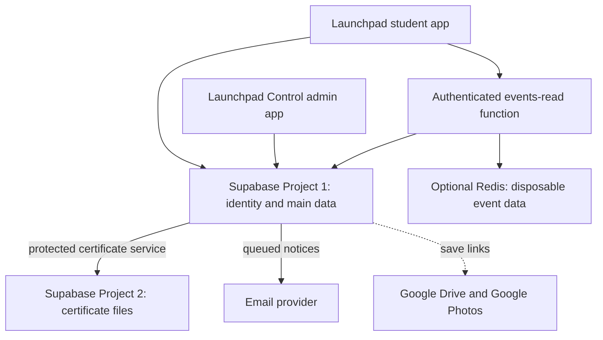

# TechSpace Launchpad

**Your universe. Your events. Your community.**

TechSpace Launchpad is a planned event platform for one university club. It pairs a student experience for discovering and attending events with a separate admin experience for running them.

> **Project status: Phase 1 complete; identity and event workflows implemented for development.** MAIN has profiles, audited events, atomic registration and the applied onboarding/admin-access migration. The user has selected immediate eligibility after complete onboarding and admin-managed access. Google sign-in is enabled; both app redirects reached Google and the user reported successful real login. Full deployed-origin verification remains a release check. The specification remains a draft pending stakeholder approval; this is not a launch-ready release.

## Product at a glance

| Product | Who it serves | Planned responsibilities |
|---|---|---|
| **Launchpad** | Students | Discover and register for events, view event QR codes and attendance, read announcements, and access event links and certificates |
| **Launchpad Control** | Admins | Create events, manage registrations, check in attendees, publish announcements, issue certificates, and manage event links and questions |

The two web apps are planned as separate deployments sharing one primary identity and data system. Launchpad is intended to be mobile friendly and installable as a PWA. The initial scope is one TechSpace university club, with a free tier first approach.

## Delivery plan

| Release | Planned scope |
|---|---|
| **Release 1 — event operations** | Separate student and admin apps; student onboarding and protected admin access; event creation and registration; event QR attendance; announcements with queued email; common OD links in announcements; gallery and resource links; basic dashboards and participant export; security, backup, and recovery workflows |
| **Release 2 — documents and support** | Certificate templates and issuance, secure download and verification; private event question threads and replies; optional private attachments or approved document links |

These are release requirements; only the development capabilities listed below are implemented. Release 1 is the launch foundation; Release 2 follows it.

## Implemented development workflows

- **Student welcome:** signed-out visitors land on the three illustrated introduction slides, with skip and returning-account links. `/welcome` replays the introduction; `/account` provides Google sign-in and expandable development-only email access. Profile setup collects academic details first, then department, section and mobile number, retaining the existing protected profile save.
- **Student:** profile creation/editing, published-event browsing/details, registration, My Events, and private event QR credentials for check-in. Onboarding collects name, registration number, course, branch, department, section, academic year and mobile number. Complete details give immediate eligibility; manual approval is not required.
- **Admin:** backend-checked event operations and participant views, protected access management by exact registered email with an audited reason, and mobile camera QR check-in scanning with audited corrections.
- **QR Attendance:** event-specific opaque HMAC tokens generated server-side without student roll numbers or personal details; backend enforces matching event, check-in window (`now() between starts_at and ends_at`), atomic single check-in, and audited admin manual corrections with mandatory reasons. See the [attendance runbook](docs/runbooks/attendance.md).
- **Database:** normalized unique immutable roll claims, private profile data, protected admin records, audit logs, RLS and transactional registration with capacity/duplicate checks. Profile completion is distinct from institutional verification.
- **Materials:** event-specific Google Photos album and resource links, with admin editing, publication/order controls, private draft/hidden metadata and backend audit records. Files remain on their external services.
- **Participant export:** protected event CSV download with department/year/name-or-registration filters, a ten-row preview and complete bounded snapshots. Contact information and QR credentials are excluded; downloaded text is protected against spreadsheet formulas.
- **Announcements:** admin-published dashboard notices for all students or event registrants, with audience rules enforced by MAIN RLS. Optional event-associated HTTPS links can reference one shared signed OD PDF in Google Drive. Personalized email composition, preview, private queue and progress/retry controls are implemented; a server-only Gmail worker sends batches of ten without an application daily cap. Gmail credentials, a real send and continuous hosted operation remain pending. See the [announcements runbook](docs/runbooks/announcements.md) and [email setup](docs/runbooks/announcement-email.md).
- **Redis:** optional authenticated event-read cache implementation, with fresh visibility/version checks and database fallback. The Edge Function is deployed to MAIN; Redis provisioning and real Redis connectivity remain pending. See the [Redis runbook](docs/runbooks/redis-events.md).

The `/account` page supports Google sign-in for personal Gmail and university Google accounts. The university domain confirmed by the user is `stu.srmuviversity.ac.in`; it is not an eligibility restriction. MAIN's Google provider is enabled and the user reports working login; the [Google setup runbook](docs/runbooks/google-auth.md) documents callbacks and verification for additional origins. Password test-account login remains development-only, uses real Supabase accounts and cannot bypass backend permissions. No demo credentials are bundled. Dashboard announcements and shared OD links are implemented separately from email delivery. QR attendance is implemented and development-verified; physical-device camera checks remain pending; certificates and private questions remain later work.

The initial authorized admin emails are `officialtechspaceclub@gmail.com` and `harutoxokura15@gmail.com`. Their backend authorizations are claimed only through matching confirmed Google identities; entering an email or changing profile metadata does not grant access. Existing admins can grant/revoke confirmed registered accounts from Control's Admin access screen. See the [policy decision](docs/decisions/005-student-onboarding-admin-access.md) for the data and security boundaries.

## Proposed stack and architecture

The specification chooses or proposes the following technology. Provider details and several operational choices remain open.

| Area | Chosen or proposed approach |
|---|---|
| Frontend | Next.js App Router, React, TypeScript |
| UI | Tailwind CSS and shadcn/ui |
| Hosting | Two separate Next.js deployments; Vercel configuration included |
| Identity and main data | Supabase Project 1: Auth, PostgreSQL, and row-level security |
| Protected operations | Authenticated Edge Functions or protected PostgreSQL RPCs |
| Certificate files | Private Supabase Storage in Project 2, accessed by a protected server-side service |
| Email | External provider with a queued worker; provider and worker are TBD |
| Cache | Optional Redis REST event cache implemented; provider and credentials pending. PostgreSQL remains authoritative. See the [Redis runbook](docs/runbooks/redis-events.md). |
| Event documents and photos | Store Google Drive and Google Photos links; media remains on those services |



The diagram shows the planned flow. Project 2 credentials must remain server side; Drive and Photos are link destinations, not app-managed media stores.

## Scope and principles

- Events are the organizing unit for registration, attendance, announcements, resources, galleries, questions, and certificates.
- The main Supabase project is the operational source of truth; certificate file storage is separated into a second project.
- A signed common OD is shared through an announcement with a Drive link, not managed as a separate module or copied per student.
- The MVP has two roles: student and admin. Admin permissions are assigned and enforced server side.
- The initial product excludes payments, membership approval, multi-club support, social feeds, native apps, and advanced analytics.

## Starting implementation

The repository separates `apps/student` and `apps/admin`, shared browser packages under `packages`, and the two backend projects under `supabase/main` and `supabase/certificates`. See the [folder architecture](docs/architecture.md) for every directory's responsibility and [phase.md](phase.md) for dependencies, deliverables and completion criteria.

The user originally authorized event development before Google sign-in, then selected the [onboarding and admin-access policy](docs/decisions/005-student-onboarding-admin-access.md). Personal Gmail is allowed and complete self-declared student details give immediate registration eligibility without approval. This does not establish university enrollment. Google provider activation remains pending. Email provider/queue decisions are required before Phase 5 delivery.

## Local development

Use Node.js 22.12 or later on the Node 22 line and npm; `.nvmrc` pins the development/CI version. If your version manager reports no active Node installation, install and activate the pinned version first. Install workspace dependencies from the repository root:

```sh
npm ci
```

Start each app in its own terminal:

```sh
npm run dev:student
npm run dev:admin
```

| App | Local URL | Production build | Build output |
|---|---|---|---|
| Launchpad | `http://127.0.0.1:5173` | `npm run build:student` | `apps/student/.next` |
| Launchpad Control | `http://127.0.0.1:5174` | `npm run build:admin` | `apps/admin/.next` |

Both apps use Next.js 16 App Router with file-based routes, shared workspace packages and Tailwind PostCSS. After building, `npm run start:student` and `npm run start:admin` run production servers on the same ports. The `.next` folders need a Next.js runtime. For Vercel, import this repository twice with roots `apps/student` and `apps/admin`; see the [deployment guide](docs/runbooks/frontend-deployment.md). No Vercel project or deployment has been created.

The app shells run without Supabase credentials and explain missing configuration on their setup pages; event workflows require MAIN configuration and migrations. Copy each app's `.env.example` to `.env.local` in that same app directory, fill in the public values, and restart the dev server:

| Variable | Value |
|---|---|
| `NEXT_PUBLIC_MAIN_SUPABASE_URL` | Project 1 HTTPS URL; local HTTP is accepted only for localhost/127.0.0.1 |
| `NEXT_PUBLIC_MAIN_SUPABASE_PUBLISHABLE_KEY` | Project 1 browser publishable key beginning with `sb_publishable_` |
| `NEXT_PUBLIC_MAIN_EVENTS_CACHE_ENABLED` | Optional `true` to use the deployed authenticated event-read function. Default `false` reads directly through Supabase RLS; it does not configure Redis credentials. |

Use the same Project 1 in both apps. Legacy JWT browser keys are not supported by this configuration validator. Never put service-role keys, `sb_secret_` keys, Redis tokens, email credentials or Project 2 secrets in any `NEXT_PUBLIC_` variable. A valid configuration message confirms syntax only; real requests can still fail and show an error.

### Which Supabase project goes where?

| Environment file | Project | Fields and purpose |
|---|---|---|
| `apps/student/.env.local` and `apps/admin/.env.local` | **MAIN — Project 1** | `NEXT_PUBLIC_MAIN_SUPABASE_URL`: main project URL. `NEXT_PUBLIC_MAIN_SUPABASE_PUBLISHABLE_KEY`: main project's public browser key. Use identical values in both apps. |
| `supabase/main/.env.local` | **MAIN backend only** | Optional Redis REST URL/token, cache TTL and allowed frontend origins. Copy from `.env.example` only when configuring the function; frontend builds never load these secrets. |
| `supabase/certificates/.env.local` | **CERTIFICATES — Project 2** | Future server-only `CERTIFICATES_SUPABASE_URL` and `CERTIFICATES_SUPABASE_SECRET_KEY` for private templates/PDFs. Leave blank until Release 2. |

The certificate file is a planning template, not loaded by either frontend or an implemented backend. Its privileged key will belong in the protected backend environment when certificate operations are built. Project 1 holds login, operational records and permanent certificate metadata; Project 2 holds certificate files. Local environment files are ignored by Git; committed examples contain no credentials.

The Next.js migration renames `VITE_MAIN_*` fields to `NEXT_PUBLIC_MAIN_*`. Update older local files and hosted build variables, then restart development or rebuild production. Public variables are embedded at build time. Browser publishable keys cannot apply database migrations; migration access uses the separately authenticated Supabase CLI.

The two Supabase CLI working directories are initialized and linked separately. MAIN has the identity/event migrations; CERTIFICATES has no product migrations. See the [Supabase setup runbook](docs/runbooks/supabase-setup.md) and [database/event runbook](docs/runbooks/database-events.md) for explicit target commands, verification and development account setup.

## Development checks

```sh
npm run check
npx playwright install chromium
npm run test:e2e
npm run test:production
```

`check` runs frontend/backend TypeScript checks, ESLint, unit tests and both production builds. Browser smoke tests exercise navigation and direct routes on desktop/mobile layouts. `test:production` starts the built apps on ports 5193/5194 and checks dynamic routes, HTTP 404 and the absence of development password login; run it after `check` or `build`. Unit tests cover configuration and Redis hit/miss/invalidation/outage/auth behavior with simulated services. CI runs these checks on pull requests and pushes.

With the Supabase CLI authenticated to the explicitly linked MAIN development project, run the real database and browser workflows separately:

```sh
supabase db query --linked --workdir supabase/main --file supabase/tests/identity_events.sql
supabase db query --linked --workdir supabase/main --file supabase/tests/onboarding_admin_access.sql
supabase db query --linked --workdir supabase/main --file supabase/tests/announcements.sql
supabase db query --linked --workdir supabase/main --file supabase/tests/event_materials.sql
supabase db query --linked --workdir supabase/main --file supabase/tests/participant_export.sql
supabase db query --linked --workdir supabase/main --file supabase/tests/dashboards.sql
python supabase/main/supabase/tests/concurrency.py
npm run test:live
npm run test:materials-export
node scripts/test-live-events.mjs tests/live/dashboards.spec.ts
```

The SQL suite rolls back its fixtures. Concurrency and live browser tests create synthetic accounts/events and remove them afterward; they require development-project access, email/password test login and the MAIN migration. The browser harness also checks the deployed `events-read` function, uses dedicated local test ports 5183/5184 and disables traces/screenshots containing account credentials. These remote checks are not run automatically in credential-free CI. See the runbooks for cleanup and prerequisites.

Use `npm run build` to build both apps. Separate Next.js/Vercel deployment settings and secret boundaries are documented in the [frontend deployment runbook](docs/runbooks/frontend-deployment.md). No app has been deployed by this setup.

## Open decisions

- Google OAuth activation, exact hosted callback origins and real student/admin Google login validation remain setup work; eligibility and admin-management policy are decided.
- Configure the selected club Gmail sender credentials, verify a real send, and select/test continuous worker hosting. The user chose an own Node/Nodemailer worker and no application daily recipient cap; see [decision 006](docs/decisions/006-gmail-announcement-email.md).
- How private query attachments, certificate retention, data retention, and institutional consent will be handled.
- Which TechSpace-owned domains and authorized visual assets will be used at public launch.
- Whether registration cancellation is needed for the initial event policy.

See the specification for suggested defaults and the point at which each decision is required.

## Project documents

- [Project instructions](AGENTS.md)
- [Folder architecture](docs/architecture.md)
- [Phased delivery workflow](phase.md)
- [Phase 1 implementation decisions](docs/decisions/001-phase-1-foundations.md)
- [Next.js migration decision](docs/decisions/004-nextjs-migration.md)
- [Student onboarding and admin-access decision](docs/decisions/005-student-onboarding-admin-access.md)
- [Google sign-in setup](docs/runbooks/google-auth.md)
- [Frontend deployment runbook](docs/runbooks/frontend-deployment.md)
- [Supabase setup](docs/runbooks/supabase-setup.md)
- [Database and event workflows](docs/runbooks/database-events.md)
- [Redis event cache](docs/runbooks/redis-events.md)
- [Product specification and source of truth](TechSpace_Launchpad_SOURCE_OF_TRUTH.md) — draft v2.0.0, pending stakeholder approval


Gallery/resource setup and validation are in the [event materials runbook](docs/runbooks/event-materials.md); export filters, bounds and CSV behavior are in the [participant export runbook](docs/runbooks/participant-export.md). `test:materials-export` needs both development servers running and linked MAIN migrations; set `MATERIALS_STUDENT_ORIGIN` and `MATERIALS_ADMIN_ORIGIN` when using different ports. It creates 105 synthetic participants and cleans its fixtures afterward. It does not open external Photos/Drive files.
