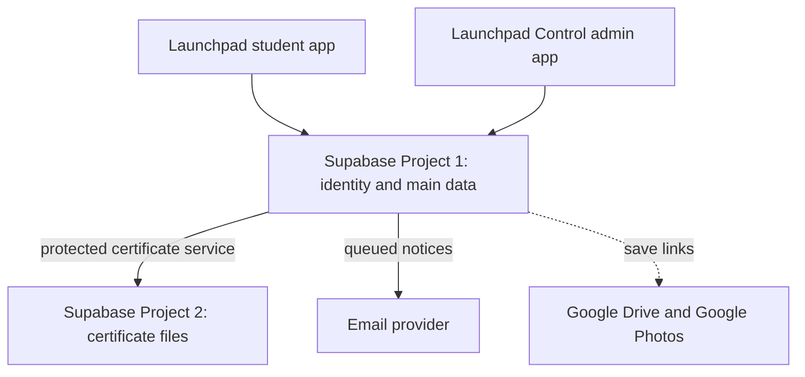

# TechSpace Launchpad

**Your universe. Your events. Your community.**

TechSpace Launchpad is a planned event platform for one university club. It pairs a student experience for discovering and attending events with a separate admin experience for running them.

> **Project status: Phase 1 foundations implemented; validation pending.** Student and admin app shells, shared packages and development checks are in place. Full installation/build/browser checks are blocked in the current session; see [phase.md](phase.md) for evidence and remaining checks. Login, database workflows and event operations are later phases. The specification is a draft pending stakeholder approval.

## Product at a glance

| Product | Who it serves | Planned responsibilities |
|---|---|---|
| **Launchpad** | Students | Discover and register for events, view event QR codes and attendance, read announcements, and access event links and certificates |
| **Launchpad Control** | Admins | Create events, manage registrations, check in attendees, publish announcements, issue certificates, and manage event links and questions |

The two web apps are planned as separate deployments sharing one primary identity and data system. Launchpad is intended to be mobile friendly and installable as a PWA. The initial scope is one TechSpace university club, with a free tier first approach.

## Delivery plan

| Release | Planned scope |
|---|---|
| **Release 1 — event operations** | Separate student and admin apps; student onboarding and protected admin access; event creation and registration; event QR attendance; announcements with queued email; common OD links in announcements; gallery and resource links; basic dashboards and participant export; security, backup, and recovery workflows |
| **Release 2 — documents and support** | Certificate templates and issuance, secure download and verification; private event question threads and replies; optional private attachments or approved document links |

These are planned requirements, not implemented features. Release 1 is the launch foundation; Release 2 follows it.

## Proposed stack and architecture

The specification chooses or proposes the following technology. Provider details and several operational choices remain open.

| Area | Chosen or proposed approach |
|---|---|
| Frontend | React, TypeScript, Vite |
| UI | Tailwind CSS and shadcn/ui |
| Hosting | Two separate Cloudflare Pages deployments |
| Identity and main data | Supabase Project 1: Auth, PostgreSQL, and row-level security |
| Protected operations | Authenticated Edge Functions or protected PostgreSQL RPCs |
| Certificate files | Private Supabase Storage in Project 2, accessed by a protected server-side service |
| Email | External provider with a queued worker; provider and worker are TBD |
| Event documents and photos | Store Google Drive and Google Photos links; media remains on those services |



The diagram shows the planned flow. Project 2 credentials must remain server side; Drive and Photos are link destinations, not app-managed media stores.

## Scope and principles

- Events are the organizing unit for registration, attendance, announcements, resources, galleries, questions, and certificates.
- The main Supabase project is the operational source of truth; certificate file storage is separated into a second project.
- A signed common OD is shared through an announcement with a Drive link, not managed as a separate module or copied per student.
- The MVP has two roles: student and admin. Admin permissions are assigned and enforced server side.
- The initial product excludes payments, membership approval, multi-club support, social feeds, native apps, and advanced analytics.

## Starting implementation

The repository separates `apps/student` and `apps/admin`, shared browser packages under `packages`, and the two backend projects under `supabase/main` and `supabase/certificates`. See the [folder architecture](docs/architecture.md) for every directory's responsibility and [phase.md](phase.md) for dependencies, deliverables and completion criteria.

After validating the Phase 1 foundations, resolve student identity verification and admin provisioning before Phase 2 authentication work. Email provider/queue decisions are required before Phase 5 delivery. Follow the specification's acceptance criteria, keep changes within scope, and record approved decisions before relying on them.

## Local development

Use Node.js 22.12 or later on the Node 22 line and npm; `.nvmrc` pins the development/CI version. If your version manager reports no active Node installation, install and activate the pinned version first. Install workspace dependencies from the repository root:

```sh
npm ci
```

Start each app in its own terminal:

```sh
npm run dev:student
npm run dev:admin
```

| App | Local URL | Production build | Build output |
|---|---|---|---|
| Launchpad | `http://127.0.0.1:5173` | `npm run build:student` | `apps/student/dist` |
| Launchpad Control | `http://127.0.0.1:5174` | `npm run build:admin` | `apps/admin/dist` |

The shells run without Supabase credentials and explain missing configuration on their setup pages. To configure Project 1 later, copy each app's `.env.example` to `.env.local` in that same app directory, fill in the public values, and restart the dev server:

| Variable | Value |
|---|---|
| `VITE_SUPABASE_URL` | Project 1 HTTPS URL; local HTTP is accepted only for localhost/127.0.0.1 |
| `VITE_SUPABASE_PUBLISHABLE_KEY` | Project 1 browser publishable key beginning with `sb_publishable_` |

Use the same Project 1 in both apps. Legacy JWT keys are not supported by this foundation. Never put service-role keys, `sb_secret_` keys, email credentials or Project 2 secrets in any `VITE_` variable. Browser configuration does not enable sign-in or validate backend connectivity yet.

## Development checks

```sh
npm run check
npx playwright install chromium
npm run test:e2e
```

`check` runs TypeScript checks, ESLint, unit tests and both production builds. Browser smoke tests start both dev servers and exercise foundation navigation on desktop and mobile layouts. Unit tests cover browser configuration validation without network calls. CI runs these checks on pull requests and pushes.

Use `npm run build` to build both apps. Separate static deployment settings and secret boundaries are documented in the [frontend deployment runbook](docs/runbooks/frontend-deployment.md). No app has been deployed by this setup.

## Open decisions

- How student university identity will be verified and how admins will be provisioned.
- Which email provider and background worker will handle queued delivery, retries, and rate limits.
- How private query attachments, certificate retention, data retention, and institutional consent will be handled.
- Which TechSpace-owned domains and authorized visual assets will be used at public launch.
- Whether registration cancellation is needed for the initial event policy.

See the specification for suggested defaults and the point at which each decision is required.

## Project documents

- [Project instructions](AGENTS.md)
- [Folder architecture](docs/architecture.md)
- [Phased delivery workflow](phase.md)
- [Phase 1 implementation decisions](docs/decisions/001-phase-1-foundations.md)
- [Frontend deployment runbook](docs/runbooks/frontend-deployment.md)
- [Product specification and source of truth](TechSpace_Launchpad_SOURCE_OF_TRUTH.md) — draft v2.0.0, pending stakeholder approval

