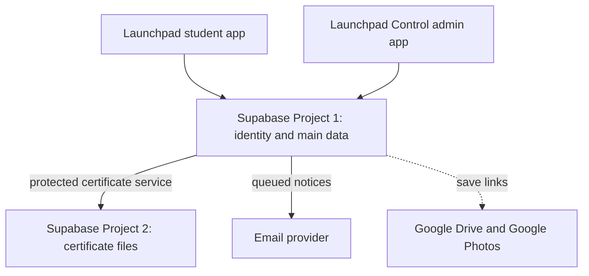

# TechSpace Launchpad

**Your universe. Your events. Your community.**

TechSpace Launchpad is a planned event platform for one university club. It pairs a student experience for discovering and attending events with a separate admin experience for running them.

> **Project status: foundation structure only.** The repository contains documentation and a directory skeleton. Runnable apps and product features have not been implemented. The specification is a draft pending stakeholder approval.

## Product at a glance

| Product | Who it serves | Planned responsibilities |
|---|---|---|
| **Launchpad** | Students | Discover and register for events, view event QR codes and attendance, read announcements, and access event links and certificates |
| **Launchpad Control** | Admins | Create events, manage registrations, check in attendees, publish announcements, issue certificates, and manage event links and questions |

The two web apps are planned as separate deployments sharing one primary identity and data system. Launchpad is intended to be mobile friendly and installable as a PWA. The initial scope is one TechSpace university club, with a free tier first approach.

## Delivery plan

| Release | Planned scope |
|---|---|
| **Release 1 — event operations** | Separate student and admin apps; student onboarding and protected admin access; event creation and registration; event QR attendance; announcements with queued email; common OD links in announcements; gallery and resource links; basic dashboards and participant export; security, backup, and recovery workflows |
| **Release 2 — documents and support** | Certificate templates and issuance, secure download and verification; private event question threads and replies; optional private attachments or approved document links |

These are planned requirements, not implemented features. Release 1 is the launch foundation; Release 2 follows it.

## Proposed stack and architecture

The specification chooses or proposes the following technology. Provider details and several operational choices remain open.

| Area | Chosen or proposed approach |
|---|---|
| Frontend | React, TypeScript, Vite |
| UI | Tailwind CSS and shadcn/ui |
| Hosting | Two separate Cloudflare Pages deployments |
| Identity and main data | Supabase Project 1: Auth, PostgreSQL, and row-level security |
| Protected operations | Authenticated Edge Functions or protected PostgreSQL RPCs |
| Certificate files | Private Supabase Storage in Project 2, accessed by a protected server-side service |
| Email | External provider with a queued worker; provider and worker are TBD |
| Event documents and photos | Store Google Drive and Google Photos links; media remains on those services |

The diagram shows the planned flow. Project 2 credentials must remain server side; Drive and Photos are link destinations, not app-managed media stores.

## Scope and principles

- Events are the organizing unit for registration, attendance, announcements, resources, galleries, questions, and certificates.
- The main Supabase project is the operational source of truth; certificate file storage is separated into a second project.
- A signed common OD is shared through an announcement with a Drive link, not managed as a separate module or copied per student.
- The MVP has two roles: student and admin. Admin permissions are assigned and enforced server side.
- The initial product excludes payments, membership approval, multi-club support, social feeds, native apps, and advanced analytics.

## Starting implementation

The repository separates `apps/student` and `apps/admin`, shared browser packages under `packages`, and the two backend projects under `supabase/main` and `supabase/certificates`. See the [folder architecture](docs/architecture.md) for every directory's responsibility and [phase.md](phase.md) for dependencies, deliverables and completion criteria.

Begin by reviewing the specification and resolving the decisions needed for the first workflow: student identity verification, admin provisioning, project setup, and email provider/queue. Once the draft is approved, establish the two app boundaries and shared data/auth model, then implement the event registration and attendance path against the acceptance criteria. Keep changes within the stated scope and document any approved decisions before relying on them.

There are no setup or run commands yet because no application scaffold exists.

## Open decisions

- How student university identity will be verified and how admins will be provisioned.
- Which email provider and background worker will handle queued delivery, retries, and rate limits.
- How private query attachments, certificate retention, data retention, and institutional consent will be handled.
- Which TechSpace-owned domains and authorized visual assets will be used at public launch.
- Whether registration cancellation is needed for the initial event policy.

See the specification for suggested defaults and the point at which each decision is required.

## Project documents

- [Project instructions](AGENTS.md)
- [Folder architecture](docs/architecture.md)
- [Phased delivery workflow](phase.md)
- [Product specification and source of truth](TechSpace_Launchpad_SOURCE_OF_TRUTH.md) — draft v2.0.0, pending stakeholder approval

