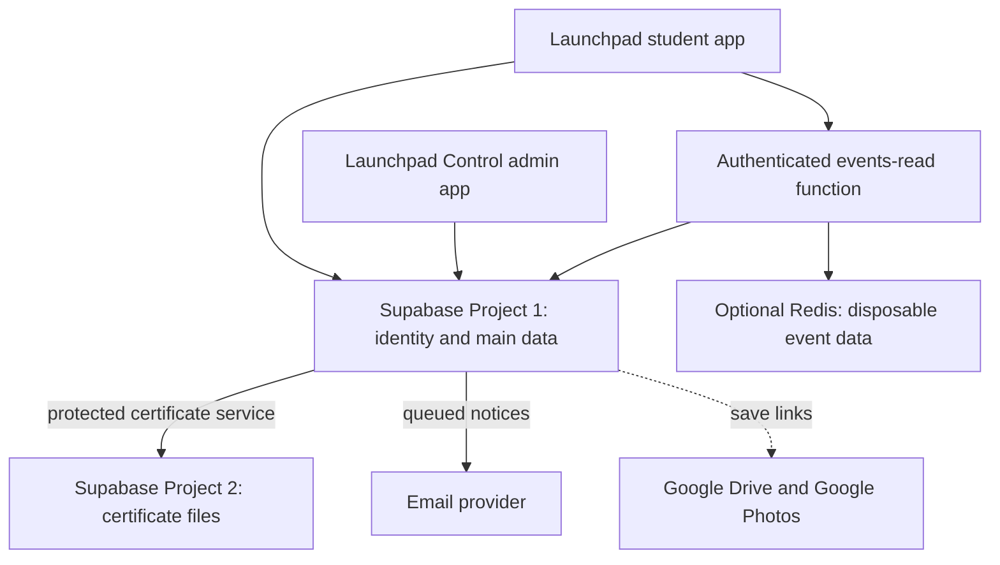

# TechSpace Launchpad

**Your universe. Your events. Your community.**

TechSpace Launchpad is a planned event platform for one university club. It pairs a student experience for discovering and attending events with a separate admin experience for running them.

> **Project status: Phase 1 complete; identity foundations and event workflows implemented for development.** MAIN now has profiles, admin authority, audited events and atomic registration with RLS. Both apps have functional event screens and development test-account access. Google sign-in, university verification policy and production admin provisioning remain deferred. The specification remains a draft pending stakeholder approval; this is not a launch-ready release.

## Product at a glance

| Product | Who it serves | Planned responsibilities |
|---|---|---|
| **Launchpad** | Students | Discover and register for events, view event QR codes and attendance, read announcements, and access event links and certificates |
| **Launchpad Control** | Admins | Create events, manage registrations, check in attendees, publish announcements, issue certificates, and manage event links and questions |

The two web apps are planned as separate deployments sharing one primary identity and data system. Launchpad is intended to be mobile friendly and installable as a PWA. The initial scope is one TechSpace university club, with a free tier first approach.

## Delivery plan

| Release | Planned scope |
|---|---|
| **Release 1 — event operations** | Separate student and admin apps; student onboarding and protected admin access; event creation and registration; event QR attendance; announcements with queued email; common OD links in announcements; gallery and resource links; basic dashboards and participant export; security, backup, and recovery workflows |
| **Release 2 — documents and support** | Certificate templates and issuance, secure download and verification; private event question threads and replies; optional private attachments or approved document links |

These are release requirements; only the development capabilities listed below are implemented. Release 1 is the launch foundation; Release 2 follows it.

## Implemented development workflows

- **Student:** real test-account sign-in, profile creation/editing, published-event browsing/details, registration and My Events.
- **Admin:** backend-checked access, event creation/editing/publishing/closing/completing/cancelling and paginated participant views.
- **Database:** normalized unique roll claims, unverified profiles by default, protected admin records, audit logs, RLS and transactional registration with capacity/duplicate checks.
- **Redis:** optional authenticated event-read cache implementation, with fresh visibility/version checks and database fallback. The Edge Function is deployed to MAIN; Redis provisioning and real Redis connectivity remain pending. See the [Redis runbook](docs/runbooks/redis-events.md).

The `/account` email/password form exists only in development builds and uses real Supabase test users. It does not bypass database permissions or verify students. Production builds have no sign-in entry point until Google is connected. No demo accounts or credentials are bundled. QR attendance, announcements/email, materials, certificates and private questions are not implemented.

## Proposed stack and architecture

The specification chooses or proposes the following technology. Provider details and several operational choices remain open.

| Area | Chosen or proposed approach |
|---|---|
| Frontend | React, TypeScript, Vite |
| UI | Tailwind CSS and shadcn/ui |
| Hosting | Two separate Cloudflare Pages deployments |
| Identity and main data | Supabase Project 1: Auth, PostgreSQL, and row-level security |
| Protected operations | Authenticated Edge Functions or protected PostgreSQL RPCs |
| Certificate files | Private Supabase Storage in Project 2, accessed by a protected server-side service |
| Email | External provider with a queued worker; provider and worker are TBD |
| Cache | Optional Redis REST event cache implemented; provider and credentials pending. PostgreSQL remains authoritative. See the [Redis runbook](docs/runbooks/redis-events.md). |
| Event documents and photos | Store Google Drive and Google Photos links; media remains on those services |



The diagram shows the planned flow. Project 2 credentials must remain server side; Drive and Photos are link destinations, not app-managed media stores.

## Scope and principles

- Events are the organizing unit for registration, attendance, announcements, resources, galleries, questions, and certificates.
- The main Supabase project is the operational source of truth; certificate file storage is separated into a second project.
- A signed common OD is shared through an announcement with a Drive link, not managed as a separate module or copied per student.
- The MVP has two roles: student and admin. Admin permissions are assigned and enforced server side.
- The initial product excludes payments, membership approval, multi-club support, social feeds, native apps, and advanced analytics.

## Starting implementation

The repository separates `apps/student` and `apps/admin`, shared browser packages under `packages`, and the two backend projects under `supabase/main` and `supabase/certificates`. See the [folder architecture](docs/architecture.md) for every directory's responsibility and [phase.md](phase.md) for dependencies, deliverables and completion criteria.

The user authorized event development before Google sign-in. Development uses real, explicitly provisioned test identities while production university verification and admin provisioning remain unresolved. See the [development access decision](docs/decisions/003-development-access.md). Email provider/queue decisions are required before Phase 5 delivery.

## Local development

Use Node.js 22.12 or later on the Node 22 line and npm; `.nvmrc` pins the development/CI version. If your version manager reports no active Node installation, install and activate the pinned version first. Install workspace dependencies from the repository root:

```sh
npm ci
```

Start each app in its own terminal:

```sh
npm run dev:student
npm run dev:admin
```

| App | Local URL | Production build | Build output |
|---|---|---|---|
| Launchpad | `http://127.0.0.1:5173` | `npm run build:student` | `apps/student/dist` |
| Launchpad Control | `http://127.0.0.1:5174` | `npm run build:admin` | `apps/admin/dist` |

The app shells run without Supabase credentials and explain missing configuration on their setup pages; event workflows require MAIN configuration and migrations. Copy each app's `.env.example` to `.env.local` in that same app directory, fill in the public values, and restart the dev server:

| Variable | Value |
|---|---|
| `VITE_MAIN_SUPABASE_URL` | Project 1 HTTPS URL; local HTTP is accepted only for localhost/127.0.0.1 |
| `VITE_MAIN_SUPABASE_PUBLISHABLE_KEY` | Project 1 browser publishable key beginning with `sb_publishable_` |
| `VITE_MAIN_EVENTS_CACHE_ENABLED` | Optional `true` to use the deployed authenticated event-read function. Default `false` reads directly through Supabase RLS; it does not configure Redis credentials. |

Use the same Project 1 in both apps. Legacy JWT browser keys are not supported by this configuration validator. Never put service-role keys, `sb_secret_` keys, Redis tokens, email credentials or Project 2 secrets in any `VITE_` variable. A valid configuration message confirms syntax only; real requests can still fail and show an error.

### Which Supabase project goes where?

| Environment file | Project | Fields and purpose |
|---|---|---|
| `apps/student/.env.local` and `apps/admin/.env.local` | **MAIN — Project 1** | `VITE_MAIN_SUPABASE_URL`: main project URL. `VITE_MAIN_SUPABASE_PUBLISHABLE_KEY`: main project's public browser key. Use identical values in both apps. |
| `supabase/main/.env.local` | **MAIN backend only** | Optional Redis REST URL/token, cache TTL and allowed frontend origins. Copy from `.env.example` only when configuring the function; frontend builds never load these secrets. |
| `supabase/certificates/.env.local` | **CERTIFICATES — Project 2** | Future server-only `CERTIFICATES_SUPABASE_URL` and `CERTIFICATES_SUPABASE_SECRET_KEY` for private templates/PDFs. Leave blank until Release 2. |

The certificate file is a planning template, not loaded by either frontend or an implemented backend. Its privileged key will belong in the protected backend environment when certificate operations are built. Project 1 holds login, operational records and permanent certificate metadata; Project 2 holds certificate files. Local environment files are ignored by Git; committed examples contain no credentials.

The `MAIN` field names replace the earlier `VITE_SUPABASE_URL` and `VITE_SUPABASE_PUBLISHABLE_KEY` names. Update older local files to the new names and restart the dev servers. Browser publishable keys cannot apply database migrations; migration access uses the separately authenticated Supabase CLI.

The two Supabase CLI working directories are initialized and linked separately. MAIN has the identity/event migrations; CERTIFICATES has no product migrations. See the [Supabase setup runbook](docs/runbooks/supabase-setup.md) and [database/event runbook](docs/runbooks/database-events.md) for explicit target commands, verification and development account setup.

## Development checks

```sh
npm run check
npx playwright install chromium
npm run test:e2e
```

`check` runs frontend/backend TypeScript checks, ESLint, unit tests and both production builds. Browser smoke tests start both dev servers and exercise foundation navigation on desktop and mobile layouts. Unit tests cover configuration and Redis hit/miss/invalidation/outage/auth behavior with simulated services. CI runs these checks on pull requests and pushes.

With the Supabase CLI authenticated to the explicitly linked MAIN development project, run the real database and browser workflows separately:

```sh
supabase db query --linked --workdir supabase/main --file supabase/tests/identity_events.sql
python supabase/main/supabase/tests/concurrency.py
npm run test:live
```

The SQL suite rolls back its fixtures. Concurrency and live browser tests create synthetic accounts/events and remove them afterward; they require development-project access, email/password test login and the MAIN migration. The browser harness also checks the deployed `events-read` function, uses dedicated local test ports 5183/5184 and disables traces/screenshots containing account credentials. These remote checks are not run automatically in credential-free CI. See the runbooks for cleanup and prerequisites.

Use `npm run build` to build both apps. Separate static deployment settings and secret boundaries are documented in the [frontend deployment runbook](docs/runbooks/frontend-deployment.md). No app has been deployed by this setup.

## Open decisions

- How student university identity will be verified and how admins will be provisioned.
- Which email provider and background worker will handle queued delivery, retries, and rate limits.
- How private query attachments, certificate retention, data retention, and institutional consent will be handled.
- Which TechSpace-owned domains and authorized visual assets will be used at public launch.
- Whether registration cancellation is needed for the initial event policy.

See the specification for suggested defaults and the point at which each decision is required.

## Project documents

- [Project instructions](AGENTS.md)
- [Folder architecture](docs/architecture.md)
- [Phased delivery workflow](phase.md)
- [Phase 1 implementation decisions](docs/decisions/001-phase-1-foundations.md)
- [Frontend deployment runbook](docs/runbooks/frontend-deployment.md)
- [Supabase setup](docs/runbooks/supabase-setup.md)
- [Database and event workflows](docs/runbooks/database-events.md)
- [Redis event cache](docs/runbooks/redis-events.md)
- [Product specification and source of truth](TechSpace_Launchpad_SOURCE_OF_TRUTH.md) — draft v2.0.0, pending stakeholder approval

