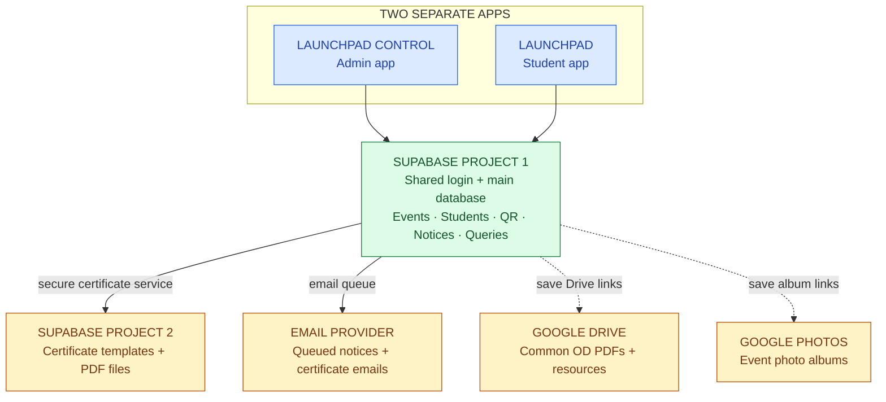
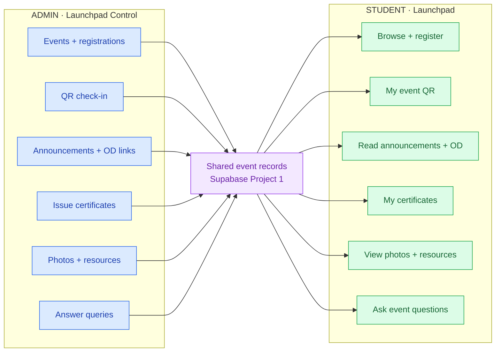
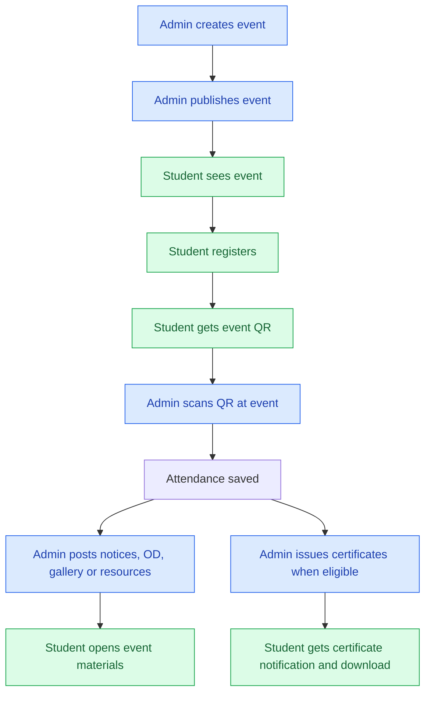
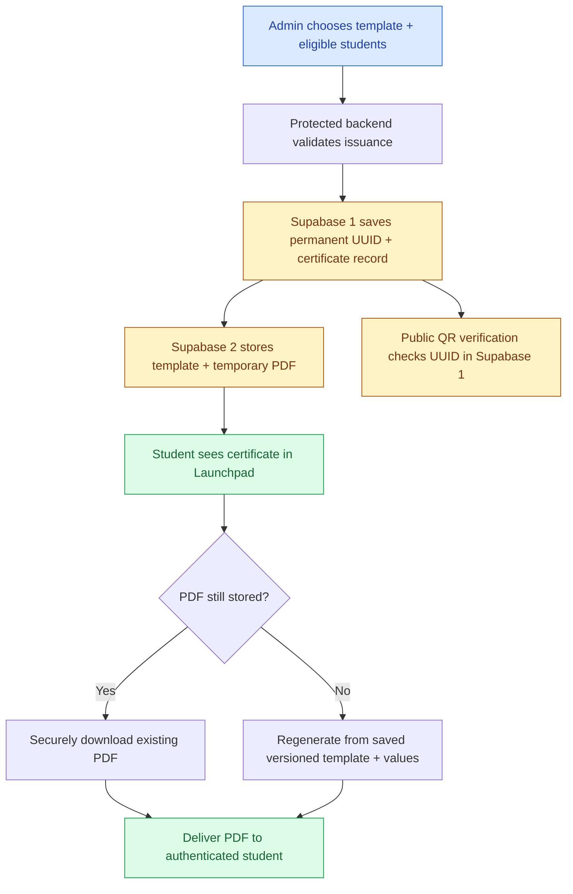

# TechSpace Launchpad

> **Your universe. Your events. Your community.**  
> **Source-of-truth product requirements and architecture** — v2.0.0, 19 November 2026

**Status:** Draft, pending approval. **Target:** one TechSpace university club, initially ~400–1,000+ students. **Constraint:** free-tier-first, mobile-friendly, secure, and intentionally small.  
**Product surfaces:** **Launchpad** (student app) and **Launchpad Control** (admin app). These are two **separately deployed applications**, with one shared primary identity/data system.

## 0. How to use this document

- This file is the canonical specification for design, implementation, testing, and AI-assisted development. Do not implement features that are not explicitly in scope.
- When an earlier PRD or conversation conflicts with this document, **this document wins once approved**.
- **Confirmed** means an agreed product decision; **Proposed** means a recommended implementation detail still subject to validation; **Open** means a decision required before shipping the relevant feature.
- The Mermaid diagrams below are **embedded directly in this Markdown**; GitHub and Mermaid-capable Obsidian previews can render them without separate image files.
- The original `University_Club_Management_PRD_v1.1.docx` is historical context. The decisions here deliberately reduce its scope.

## 1. Product at a glance

**Problem:** TechSpace operations are spread across event forms, spreadsheets, messaging, drives, and photo albums. Registration, attendance, announcements, and certificates require repeated manual effort.

**Solution:** A minimal event-centered platform where admins create and operate events while students discover, register for, attend, and access their event records and materials.

**Product principles:**
1. **Event-first:** each event owns its participants, QR attendance, announcements, resources, gallery, queries, and certificates.
2. **Two apps, one source of truth:** admin and student UIs are separate; core data and login are shared.
3. **Store metadata, link large files:** event photos live in Google Photos; signed common OD PDFs and resources live in Google Drive.
4. **A common OD is an announcement**, not a dedicated module.
5. **Certificate operations have their own Supabase project**, but verification records live permanently in the main project.
6. **Dashboard delivery is reliable first; email is queued best-effort** within provider limits.
7. **No club-membership approval flow, payments, complex analytics, social network, or multi-club platform**.

## 2. User roles and applications

There are **two end-user roles only** in the MVP. A trusted admin may also scan attendance; a separate volunteer role is not required at launch. Admin permissions are assigned server-side.

| Role | Application | Purpose |
|---|---|---|
| **Student** | **Launchpad** | Register for events, view event QR, announcements, gallery, resources, issued certificates, and private event questions |
| **Admin** | **Launchpad Control** | Create events, see registrations, check in attendees, send announcements, issue certificates, add gallery/resource links, and answer queries |

### Role-to-feature map

| Feature | Launchpad Control (Admin) | Launchpad (Student) | Stored/handled by |
|---|---|---|---|
| Sign-in and profile | Admin login; view necessary participant details | Google login; complete basic student profile | Main Supabase Auth + DB |
| Events | Create, edit, publish, close, cancel | Browse and view published events | Main Supabase DB |
| Registration | View/export participants | Register; see status and My Events | Main Supabase DB |
| QR attendance | Scan/validate QR, inspect and correct check-ins | Display personal event-specific QR, view attendance | Main DB + protected function |
| Announcements | Compose custom message; target all students or event registrants; dashboard/email/both | Read dashboard notices; receive emails where sent | Main DB + email queue/provider |
| Common signed OD | Publish Drive PDF link in an announcement | Open/download from announcement | Google Drive + announcement URL |
| Certificates | Upload/select template; issue, revoke, notify | View issued records; securely download/verify | Main metadata + second Supabase project |
| Photos | Add Google Photos album link | Open album | Main DB stores URL; Google Photos hosts media |
| Event resources | Add labeled Drive/approved links | Open resource links | Main DB stores URL; Drive hosts files |
| Event queries | Read/reply in private threads; provide attachments/links | Ask question, reply, share document/link | Main DB + approved attachment location |
| Dashboard | Basic upcoming-event/registration/attendance figures | Relevant events, activity, notices | Main DB |

## 3. Readable system architecture

**How to read:** the two top boxes are independent web apps. Both use the **same main Supabase project**. The main system delegates certificate-file work to a protected service backed by **Supabase Project 2**. For Drive and Photos, **only links** are recorded in the main database. Email is delivered through a queue and external provider.

> **Security clarification:** the arrows are a **conceptual data flow**, not permission to expose the Project 2 service-role key or other private credentials in browsers. Privileged operations go through authenticated, authorized backend functions. Both apps authenticate against Project 1.

### Feature blocks by role

> Every row represents an **admin action → shared system record → student experience**. The diagram is functional, not a claim that each action requires a separate microservice or database.

## 4. Screens and navigation

**Launchpad Control (Admin):** Dashboard · Events (detail includes registrations, QR scanning, certificates, gallery/resources, queries) · Admin access · Announcements · Certificate Templates · Settings (minimal).

**Launchpad (Student):** Home · Explore Events · My Events (QR and attendance) · Announcements · My Certificates · Profile. Event detail includes Gallery, Resources, and Questions as tabs/sections, not standalone applications.

**Mobile-first:** Student app is a responsive installable PWA; admin app must support browser camera scanning on supported phones. Both work in a standard HTTPS browser; no APK or app-store publication.

## 5. Functional requirements

### F01 — Google sign-in and profiles (MVP)
- **Student:** Sign in with a personal Gmail or university Google account. Complete onboarding with full name, unique normalized registration/roll number, course, branch, department, section, academic year and mobile number. The user-confirmed university address format is `registration_number@stu.srmuviversity.ac.in`; this domain is informative, not a sign-in restriction.
- **Eligibility — confirmed by user, 20 November 2026:** completing these details makes the student eligible to register immediately. No manual approval or institutional verification is required. Google ownership and self-declared profile details do not prove enrollment; retain verification metadata without presenting completion as verified university identity.
- **Admin:** permission comes from protected backend records. Initial authorized emails are `officialtechspaceclub@gmail.com` and `harutoxokura15@gmail.com`. Automatic initial access requires a confirmed Google identity matching an active backend authorization; editable browser/user metadata cannot grant admin status.
- **Admin workflow — confirmed by user:** a current admin may grant or revoke access for a confirmed registered account by exact email with a recorded reason. Enforce authority, audit actor/time/reason and reject self-revocation on the backend. Serialize role changes and recheck the actor's authority inside the lock. Keep only the student and admin roles.
- **Rules:** returning users reuse their profile. Normalized roll claims are unique and immutable through the student profile RPC. Students may edit other permitted profile details. New fields may remain null on legacy records until completed; do not invent profile data during migration. No official club membership process.
- **Integration pending:** Google OAuth provider activation and real Google login validation. See the [onboarding/admin decision](docs/decisions/005-student-onboarding-admin-access.md) and [Google setup runbook](docs/runbooks/google-auth.md). These scoped decisions do not approve the whole draft specification.

### F02 — Events and registration (MVP)
- **Admin:** Create/edit/publish/complete/cancel events with title, description, poster URL, date/time, venue, registration opening/closing, optional capacity.
- **Student:** Browse published events, view details, register once, see confirmation and My Events.
- **Rules:** Only published/open events accept registrations; eligibility and capacity are enforced **server-side and atomically**, including simultaneous requests; one active registration per student per event; clear handling of cancellation and closed registration.
- **Not required:** waitlists, payment, official club membership gates, complicated custom forms.

### F03 — QR attendance (MVP)
- **Student:** On registration, view a **per-event QR credential**, not a plain roll number.
- **Admin:** Scan via browser camera; backend confirms scanner permission, event, valid registration, time window, and unused check-in. Show success/failure clearly.
- **Rules:** One primary check-in per student/event; invalid, duplicate, and wrong-event scans fail; manual correction requires admin and records who/when/why. Initial version requires connectivity.

### F04 — Announcements, OD, and email (MVP)
- **Admin:** Set title, custom message, optional event, optional link, **audience** (`all_students` or `event_registrants`), and **delivery** (`dashboard`, `email`, `both`).
- **Student:** Read announcements on their dashboard; targeted students may receive email.
- **Common signed OD:** Admin uploads **one physically signed PDF to Google Drive**, copies the authorized link into an **event announcement**, and chooses recipients. Students open the same PDF. **No standalone OD module, OD table, per-student OD PDF copies, or OD generation.**
- **Delivery reliability:** Publishing an announcement stores it in the DB immediately; email jobs run separately with rate limits, retries and delivery status. A failed email does not invalidate an already published dashboard announcement.
- **Open:** choose email provider, verified sender/domain and exact retry/cadence limits. Do **not** assume free tier permits instant bulk mailing to 500 recipients.

**Incremental implementation authorized by the user, 20 November 2026:** dashboard announcements and existing shared OD links are implemented first. Email provider, verified sender, queue worker, retries and delivery status remain pending. This increment does not complete all of F04 or AT-08. Notices use one ordinary optional HTTPS link; reminders may reuse the same external PDF without an OD-specific module or table.

### F05 — Certificates (Phase 2)
- **Admin:** Upload own reusable PDF/image template; configure placement of name, event, date, certificate ID and verification QR; select eligible students; preview; confirm issuance; optionally email notification or PDF attachment if delivery constraints permit.
- **Student:** See issued certificates attached to profile; download own PDF; access public verification URL.
- **Main Supabase (Project 1):** authoritative certificate UUID, student/event association, template ID/version, immutable printed data, issuance/revocation status, dates, and storage reference.
- **Certificate Supabase (Project 2):** private templates/assets and generated PDFs; accessed through a protected certificate service only.
- **Storage policy:** Prefer on-demand generation or short-lived PDFs with optional configurable retention (proposed 30 days). After cleanup, recreate the same issued certificate from preserved inputs and **immutable, versioned template assets**. Never delete the only copy of a template needed for regeneration. Browser cache is only an optimization; do not use `localStorage` as the source of record or assume private PDFs safely persist there.
- **Verification:** QR points to public verification endpoint showing minimal non-sensitive data and valid/revoked status; never let a student issue or self-approve a certificate.
- **Eligibility:** Admin-controlled selection; where participation certificates depend on check-in, verify attendance; winner-specific automation is not needed in MVP.
- **Open:** template editor rules/coordinate system, retention, certificate eligibility and email attachment versus notification-link policy.

### F06 — Galleries and resources (MVP)
- **Photos:** Admin puts event images in a Google Photos album and adds the album URL. Student opens the album externally. No photo uploads into Supabase, no full Google Photos API.
- **Resources:** Admin attaches labeled Google Drive or approved external URLs to an event. Student clicks links from event detail. Only labels, visibility, order and URLs are stored in the main DB.
- **Privacy:** Validate URLs and sharing permissions; **anyone-with-link** albums/Drive files can be forwarded. For sensitive materials use institution-approved restricted sharing. Do not promise app-level access control over files once externally shared.

### F07 — Event questions (Phase 2)
- **Student:** Create a private question thread associated with an event, send text and optionally a document/approved file link.
- **Admin:** View and reply to those threads; optionally close a resolved thread.
- **Rules:** Only the owning student and authorized admin access private threads. Keep message history. Basic pagination and file-size/type limits if upload is enabled.
- **Scope control:** no group chat, typing indicators, read receipts, real-time presence or voice/video chat. **Open:** choose private upload storage versus external link-only documents. For truly private attachments, avoid public Drive links.

### F08 — Minimal dashboards (MVP)
- **Admin:** upcoming events, registration counts, attendance counts and recent announcements; filtered participant CSV export.
- **Student:** upcoming events, My Events/QR, latest announcements and shortcuts to relevant records.
- No advanced analytics dashboards or cross-term reporting required.

## 6. End-to-end event workflow

## 7. Certificate workflow: clear separation

## 8. Data model (proposed; adjust through migrations)

**Project 1: primary PostgreSQL**

| Table | Minimal fields / responsibility |
|---|---|
| `profiles` | `user_id`, roll number (unique normalized), name, course, branch, department, section, academic year, mobile number, verification metadata |
| `admin_users` | protected `user_id`, active state |
| `admin_email_access` | protected normalized authorized email, active state, linked user where present, change actor/time/reason |
| `events` | `id`, title, description, times, venue, status, registration window, capacity, poster URL |
| `registrations` | `id`, event ID, user ID, state, created timestamp; unique student/event |
| `attendance` | `id`, event ID, registration ID, timestamp, checked_by, correction audit; unique primary check-in |
| `announcements` | `id`, event ID nullable, title, body, link, audience, delivery, published timestamp |
| `email_jobs` | announcement/certificate ref, recipient, status, attempts, error, next attempt |
| `certificates` | UUID, owner, event, template/version, exact printed values, issued/revoked status, file ref |
| `certificate_templates` | name, version, Project 2 template location, config; never overwrite issued versions |
| `event_links` | event ID, type (`gallery`/`resource`), label, external URL |
| `event_queries` | event ID, creator ID, subject, state |
| `query_messages` | thread ID, sender ID, text, timestamp |
| `query_attachments` | optional private file ref or reviewed external link |
| `audit_logs` | privileged action, actor, entity, time, reason where applicable |

**Project 2:** private Supabase Storage buckets (`certificate-templates`, `certificate-pdfs`). Add auxiliary database tables only if actually necessary. **No duplicate student/event source-of-truth records.**

**Data links:** `profiles → registrations → events`; `attendance → registration`; `certificates → owner + event`; `announcements → event (optional)`; `event_links → event`; `event_queries → event + student → query_messages`.

## 9. Technical architecture and contracts

| Layer | Chosen/proposed approach |
|---|---|
| Frontend | Next.js App Router + React + TypeScript; user-authorized migration, 20 November 2026 |
| UI | Tailwind CSS + shadcn/ui |
| Hosting | Two independent Next.js deployments, separate routes/URLs; Vercel configuration included by user request. Cloudflare needs a compatible Next.js runtime adapter instead of static Pages output. |
| Login | Supabase Auth in Project 1, Google OAuth |
| Main DB | Supabase 1 / PostgreSQL with row-level security |
| Sensitive mutations | Authenticated Edge Functions / protected PostgreSQL RPC as appropriate |
| Certificate storage | Supabase Project 2 private storage; server-only privileged access |
| Emails | External email provider with background/queued job processing (provider and worker TBD) |
| Cache | User-authorized optional Redis REST cache for authenticated event content, with fresh database visibility/version checks and database fallback; implementation exists, provider/provisioning and live Redis verification pending. See the [Redis decision record](docs/decisions/002-redis-direction.md) and [runbook](docs/runbooks/redis-events.md). |
| OD/resources | Google Drive shared/restricted links; URL records only |
| Galleries | Google Photos shared-album links; URL records only |
| App form factor | PWA / HTTPS, no native APK |
| Development | GitHub + AI-assisted coding with code review and tests |

**Cross-project certificate contract (required):** browser authenticates with Project 1 → calls protected endpoint → endpoint verifies Project 1 session, user ownership/admin authority, and issuance status → uses *server-held* Project 2 credentials → returns a bounded download/issuance result. Never pass Project 2 service-role credentials to either frontend. Treat cross-project calls and regeneration failures as explicit error states.

**Hosting note:** Next.js/Vercel compatibility does not itself provision or guarantee scheduled background jobs. Select and test the email queue worker, scheduler, retries, and certificate cleanup mechanism before depending on them.

**Authorized framework change, 20 November 2026:** the user requested migration of both Vite apps to Next.js and compatibility with Vercel. This changes frontend routing/build/deployment contracts; existing Supabase identity, RLS, protected RPCs and release boundaries remain. See the [migration decision](docs/decisions/004-nextjs-migration.md). The overall v2.0.0 specification remains draft pending stakeholder approval; this request does not approve unresolved production policies.

**Authorized development order, 20 November 2026:** the user requested functional event workflows and a simple UI before Google OAuth integration. Development-only real test-account login may exercise the identity/data foundation; this does not change the Google sign-in requirement for release or approve university verification/admin-provisioning policies. See the [development access decision](docs/decisions/003-development-access.md). Redis credentials are server-only, cached data is disposable, and registration correctness remains enforced atomically in PostgreSQL.

**Subsequent identity policy approval, 20 November 2026:** the user accepted personal Gmail alongside university Google accounts, immediate event eligibility after complete onboarding without manual approval, the two initial admin emails and admin-managed grants/revocations. This supersedes earlier suggestions of a university-domain or verified-profile registration gate. Google activation is still an external setup dependency; the overall specification remains draft. Mobile numbers are private profile data subject to existing RLS and unresolved institutional retention/consent requirements.

## 10. Storage, cost and retention rules

1. **One OD PDF per event in Google Drive.** It is announced once, linked to recipients, not duplicated per student.
2. **Google Photos albums for gallery media.** Supabase stores album URLs, not photographs.
3. **Event resources are primarily links**, not duplicated Supabase blobs.
4. **Supabase 2 is logical separation**, not guaranteed extra free storage. Provider quotas may be scoped at project, organization, or account level; confirm current limits before launch.
5. **Certificate UUID and issued content are persistent**, even if temporary PDFs expire. Set cleanup only after regeneration tests pass.
6. **No guaranteed forever-free operation:** monitor database size, file storage, bandwidth, email sends, and free-project inactivity/pausing; design for recovery.
7. **Backups:** scheduled independent exports of main DB and protected certificate metadata/templates; retain and test restores. Do not rely on free-tier provider-managed backups.
8. **Email quota:** bulk notices/certificate messages must queue and throttle. A visible dashboard notice is the default reliable record; emails may arrive later.
9. **Retention:** define minimum retention for profiles, queries, attachments, audit logs and templates under university policy. Do not auto-delete student data without an approved retention rule.

## 11. Security and privacy: non-negotiable

- Row Level Security enabled for every exposed table; test ownership isolation and admin-only writes.
- Never accept `is_admin` or certificate eligibility from an untrusted browser field.
- QR attendance: scoped, validated, protected against duplicate and wrong-event scans; tokens should not expose roll numbers directly.
- Certificate creation/revocation and project-to-project storage access are backend-only.
- Avoid personal information on public certificate-verification pages beyond what is necessary.
- Use time-limited downloads or securely regenerated PDFs; private documents must not become permanently public simply because of a shared URL.
- Validate file uploads, size, type, content and privacy; sanitize user text and enforce reasonable query/email limits.
- Google Photos/Drive external sharing is **outside app-level access control**. Choose sharing deliberately and disclose that links can be forwarded if public.
- Log privileged actions; store secrets in server environments, not Git or frontend bundles.

## 12. Delivery plan

### Release 1 — Must work before real club launch
- [ ] Two separate frontends (Launchpad / Launchpad Control) using Project 1 login
- [ ] Protected admin access + student onboarding
- [ ] Event creation, publication and registration
- [ ] Unique event QR + secure attendance scanning
- [ ] Dashboard announcements + email queue and retries
- [ ] OD as announcement with Google Drive link
- [ ] Google Photos album links and event resource links
- [ ] Basic dashboards and participant export
- [ ] Security rules, duplicate prevention, backup/export and recovery test

### Release 2 — Document and support completion
- [ ] Certificate template upload and immutable versioning
- [ ] Certificate issuance, PDF download/regeneration, UUID/QR verification
- [ ] Certificate dashboard access and optional email delivery
- [ ] Private event query threads and replies
- [ ] Optional private attachments or approved document links

**Deployment rule:** a feature is only complete when a real student/admin workflow succeeds end to end, including denied unauthorized actions and failure handling. No mock success in production.

## 13. Acceptance tests

| ID | Acceptance criterion |
|---|---|
| AT-01 | Personal Gmail and university Google users complete all onboarding fields and may immediately register without approval; returning users retain their profile; duplicate normalized roll claims and incomplete profile registration are denied |
| AT-02 | Non-admin cannot invoke admin operations or grant access through direct APIs/metadata; approved initial Google identities receive access; admins can auditably grant/revoke confirmed registered accounts, with self-revocation and stale-authority role edits denied |
| AT-03 | Admin publishes an event and student can discover/register |
| AT-04 | Duplicate registration and capacity-overrun attempts are rejected under concurrency |
| AT-05 | Student gets event QR; authorized scan records exactly one check-in |
| AT-06 | Unauthorized/wrong-event/duplicate check-ins are rejected |
| AT-07 | Admin publishes custom announcement for all or event registrants; only intended users see it |
| AT-08 | Email jobs retry/rate-limit and report failures without hiding dashboard announcement |
| AT-09 | Signed OD is available from **one Drive link inside an announcement**; no duplicate PDF records |
| AT-10 | Gallery and resources open correct event-scoped external links |
| AT-11 | Admin issues certificate with unique UUID and correct immutable details |
| AT-12 | Student downloads only own private certificate; public verification reveals minimal data |
| AT-13 | Deleting temporary PDF does not break regeneration or UUID validation |
| AT-14 | Query messages are private to student and authorized admins; document visibility is enforced |
| AT-15 | Both PWAs work on mobile; scanner and download flows tested on supported devices |
| AT-16 | Database backup + restore and certificate-template recovery are tested |

## 14. Out of scope

- Club membership application/approval/renewals or members-only events
- Multi-club or university-wide operations
- Payments, ticketing, commerce
- Advanced analytics, role hierarchy, volunteer-management subsystem
- Separate OD management system or individual OD copies
- Built-in event-photo hosting, Google API synchronization, media processing pipeline
- Group chats, social feeds, live video, real-time typing indicators
- Native mobile apps, mandatory offline QR check-in
- Automated winners/ranking management (admin can manually select winner certificate recipients)

## 15. Unresolved decisions (do not invent answers in implementation)

| Decision | Suggested default | Required before |
|---|---|---|
| Student identity/eligibility | **Resolved by user, 20 November 2026:** personal Gmail or university Google; complete onboarding gives immediate eligibility, no approval. No university-verification claim. | Google activation and real onboarding validation remain required |
| Admin provisioning | **Resolved by user:** two initial authorized emails; confirmed Google bootstrap and audited admin-managed grant/revoke for confirmed registered accounts. | Backend authorization checks and real Google bootstrap validation |
| Registration cancellation | Not provided initially unless required | Event launch policy |
| Email provider / verified sender | Pick provider with documented sending limits, verified sender, queue | Email delivery |
| Private query attachment handling | Drive links for public resources; private bucket for sensitive uploads | Query attachments |
| Certificate template layout | Admin-defined fixed positions and preview | Certificate issuance |
| PDF retention | 30 days **proposed**, with safe regeneration and preserved templates | Automated cleanup |
| Certificate email | Notification + secure link by default, attachment optional | Certificate delivery |
| Source domains and branding | TechSpace-owned deployment names and authorized visuals | Public release |
| Data retention and institutional consent | Written university policy | Production rollout |

## 16. Explicit non-goals and scope-change rule

Do not add a module because a library, template, or AI agent makes it easy. Every new feature must have: (a) a clear user task, (b) one named role, (c) a workflow, (d) a database/storage implication, and (e) a testable acceptance criterion. Otherwise defer it.

---

**Specification summary:** **TechSpace Launchpad** = **Launchpad (student PWA)** + **Launchpad Control (admin PWA)** → **Supabase Project 1** as the permanent operational source of truth; **Supabase Project 2** for certificate files/templates; **Google Drive** for common OD/resources; **Google Photos** for galleries; **queued email** for notifications. Launch the core event workflow first. Keep everything else small.
